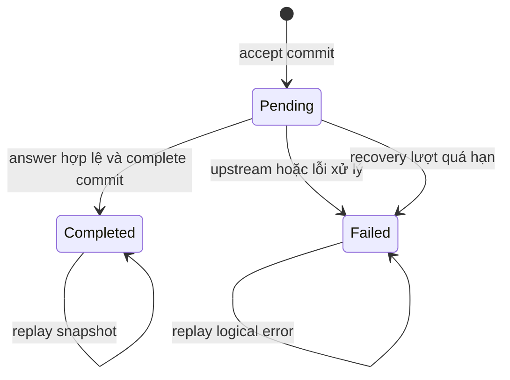

# Hội thoại, state machine và idempotency

**Loại:** thiết kế chung Team 3. **Đối chiếu source:** `62c3556`, ngày 28/10/2026.
**Căn cứ:** [ARCHITECTURE](../ARCHITECTURE.md) §6 và [CODING_CONVENTIONS](../CODING_CONVENTIONS.md) §3.3/§4.
Đây là mô tả thiết kế và implementation, không phải xác nhận phê duyệt hoặc nghiệm thu.

## 1. State machine

Source chính: [ChatStore](../../team3_fullstack/backend/src/main/java/com/legalai/backend/conversation/persistence/ChatStore.java),
[StreamService](../../team3_fullstack/backend/src/main/java/com/legalai/backend/chat/stream/StreamService.java).
DDL/keys ở [persistence-design](persistence-design.md). State DB và trạng thái UI là hai khái niệm riêng.

Sơ đồ trên là assistant message. User được tạo ngay completed. Không có failed→completed
hoặc completed→failed; retry một failed đã xác định phải dùng UUID mới và tạo cặp mới.
Kết quả AI muộn không được ghi đè terminal; mất kết nối FE không chuyển state DB.

| Thời điểm | User | Assistant | Receipt | Nội dung và tác động |
| --- | --- | --- | --- | --- |
| accept commit |completed |pending |pending |Lưu question, cấp IDs, assistant chưa content/citation |
| complete commit |completed |completed |completed |answerStatus/answer/citations + response_snapshot atomic |
| fail commit |completed |failed |failed |content/status null, errorCode, error_snapshot/logical_status |
| recovery đủ điều kiện |completed |failed |failed |PROCESSING_INTERRUPTED, bỏ kết quả muộn |
| delete sau terminal |Row bị xóa |Row bị xóa |deleted |Giữ tombstone không nội dung; corpus không đổi |

Receipt có state deleted, message không có state này. Danh sách/lịch sử không tồn tại
trả404, không trả[] để che missing conv. Xem lại lịch sử không gọi AI.

## 2. Nhận lượt, khóa và replay

1. Gọi recover trước accept; tra clientRequestId trước khi tạo conversation.
2. Nếu receipt đã có: deleted→404; khóa conv và đọc lại receipt để đồng bộ với delete.
   So hash question và conversationId nếu được gửi; mismatch→409REQUEST_ID_CONFLICT.
3. Pending→409REQUEST_IN_PROGRESS; failed→logical error; completed→snapshot replay.
   Retry không gửi conv vẫn dùng binding đã lưu; không tạo hội thoại khác.
4. UUID mới: insert receipt pending; tạo conv nếu cần, khóa row conv FOR UPDATE,
   check busy, tính sequence, tạo user+assistant và gắn receipt trong một transaction.
5. Duplicate UUID race gây DuplicateKeyException: transaction đầu rollback rồi đọc lại
   winner trong transaction mới. Không dùng map/process lock làm nguồn trạng thái chuẩn.
6. Admission/worker sau accept: semaphore mặc định8; worker đầy/rejected trả503.
   Nếu lượt mới đã được nhận thì lưu failed; replay không đổi snapshot completed.
7. Worker phát meta, gọi AI ngoài DB tx, validate/complete commit rồi mới phát answer.

Đường replay vẫn dùng admission/worker pool. Khi hết quota có thể503 trước stream,
không có lời hứa replay luôn thành công dưới mọi tải; không gọi lại AI cho replay.
Giới hạn transport/full response ở [API public](public-api-specification.md).

## 3. Ma trận IDEM-01 đến IDEM-12

| ID | Request / điều kiện | Xử lý hiện tại | AI / DB |
| --- | --- | --- | --- |
|IDEM-01|UUID mới, không conv|Tạo conv và cặp messages; SSE meta→terminal|Một lượt AI nếu qua admission; một receipt/cặp |
|IDEM-02|UUID mới, conv hợp lệ và không busy|Khóa conv, thêm cặp với sequence mới|Một lượt AI, giữ conv |
|IDEM-03|Cùng UUID/question, pending|409 REQUEST_IN_PROGRESS|Không AI/cặp mới |
|IDEM-04|Cùng UUID/question, completed|Replay Complete chuẩn bằng SSE|Không AI; IDs/time/answer giữ nguyên |
|IDEM-05|Cùng UUID/question, failed|HTTP logical error từ snapshot|Không AI; không lưu HTTP200 của stream thành status lỗi |
|IDEM-06|Cùng UUID, question khác|409 REQUEST_ID_CONFLICT|Không AI/cặp mới |
|IDEM-07|Cùng UUID, conv được gửi khác binding|409 REQUEST_ID_CONFLICT|Không chuyển binding |
|IDEM-08|Retry cùng UUID, bỏ/null conv|Tra binding cũ rồi pending/error/replay theo state|Không tự tạo conv |
|IDEM-09|Hai request cùng UUID đua nhau|Unique receipt + rollback/đọc winner|Tối đa một receipt/cặp; request sau thấy pending/replay theo thời điểm |
|IDEM-10|UUID mới nhưng conv có pending|409 CONVERSATION_BUSY|Không AI; transaction receipt mới rollback |
|IDEM-11|UUID của conv đã xóa|404 REQUEST_NOT_FOUND từ tombstone|Không tạo lại conv/AI |
|IDEM-12|Query/replay và delete đồng thời|Cùng lock row; accept thắng→delete409busy; delete thắng→query404 hoặc replay404REQUEST_NOT_FOUND|Không trả snapshot đã xóa, không để message mồ côi |

IDEM-09 không buộc request thứ hai luôn409 nếu request đầu đã completed trước khi
transaction thứ hai nhìn thấy receipt; completed replay vẫn đúng nguyên tắc một lượt AI.
Payload so theo question đã strip ở Controller. Fingerprint không tự đưa history, model,
public message IDs vào request hoặc coi history như căn cứ pháp luật.

## 4. History và tiêu đề

History dựng bằng join user/assistant cùng client_request_id và conv. Chọn tối đa5 cặp
completed/answered gần nhất trước sequence hiện tại; bỏ pending/failed/insufficient.
Cộng Unicode code point của cả question+answer, tối đa20000; quá ngân sách thì bỏ trọn
cặp cũ, trả thứ tự cũ→mới. Chỉ gửi role/content, không citations/ID/public state.

Tiêu đề theo quyết định Team 3 đã xác nhận: câu hỏi đầu của conv mới được gộp whitespace,
lấy tối đa100 code point và bỏ whitespace cuối; nếu rỗng thì “Hội thoại mới”. Conv tạo rỗng
bằng POST vẫn giữ default đến lượt đầu. Chỉ đổi default khi conv chưa có message;
giữ custom title và title ở follow-up/replay, kể cả lượt đầu thất bại sau accept.
Không tự backfill những hội thoại cũ. Quy tắc title bổ sung cho phần baseline chưa mô tả.

## 5. Recovery: yêu cầu và implementation

ARCHITECTURE §6.1 yêu cầu background recovery khi pending>60s; kế hoạch triển khai
mô tả quét mỗi30s. Source hiện tại:

- recover được gắn ApplicationReadyEvent và gọi trong accept/list/detail/messages/delete.
- Quét receipt pending có created_at cũ hơn60s, lock conv, lưu failed/PROCESSING_INTERRUPTED.
- Chưa có scheduler recovery định kỳ. ScheduledThreadPoolExecutor hiện chỉ heartbeat.
- Test gọi recover trực tiếp chứng minh xử lý stale/late output, không chứng minh job
  tự chạy khi hệ thống không có request. Đây là khoảng thiếu implementation cần xử lý,
  không sửa mô tả để coi đọc history là đủ thay background job.

## 6. Frontend retry và kiểm chứng liên quan

[useChat](../../team3_fullstack/frontend/src/hooks/useChat.ts),
[retryPolicy](../../team3_fullstack/frontend/src/api/retryPolicy.ts),
[pendingTurn](../../team3_fullstack/frontend/src/api/pendingTurn.ts) giữ UUID khi outcomeUnknown
hoặc REQUEST_IN_PROGRESS; failed đã xác định retry UUID mới. `sessionStorage` chỉ giữ
receipt chưa rõ kết quả, không giữ toàn history/key. Storage bị chặn làm giảm khả năng
phục hồi UUID sau reload trước meta; không hứa bảo đảm trong điều kiện đó.

Test nguồn: [ChatStoreTests](../../team3_fullstack/backend/src/test/java/com/legalai/backend/ChatStoreTests.java),
[PostgresChatStoreTests](../../team3_fullstack/backend/src/test/java/com/legalai/backend/PostgresChatStoreTests.java),
[StreamApiTests](../../team3_fullstack/backend/src/test/java/com/legalai/backend/StreamApiTests.java).
Các tên case race/replay/delete nằm trong những lớp này; không tạo thêm case trùng
chỉ để có một class mới đúng tên trong ví dụ kế hoạch.
