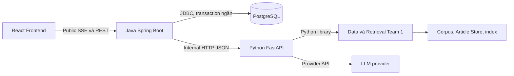

# Kiến trúc phân hệ Backend & Frontend

**Loại:** thiết kế chung Team 3. **Đối chiếu source:** `62c3556`, ngày 28/10/2026.
**Căn cứ:** [ARCHITECTURE](../ARCHITECTURE.md) và [CODING_CONVENTIONS](../CODING_CONVENTIONS.md).
Mô tả implementation không tự thay yêu cầu hoặc chứng minh đã nghiệm thu.

## 1. Phạm vi và trách nhiệm

Trợ lý hỏi đáp pháp luật doanh nghiệp và quy định liên quan trong corpus/snapshot được
công bố, theo ARCHITECTURE §1.2. Ngoài phạm vi MVP: nộp hồ sơ, ký số, tự động tính thuế,
dự đoán tố tụng và reasoning chuyên sâu. History hỗ trợ hội thoại, không là căn cứ pháp lý.

| Thành phần | Owner | Trách nhiệm |
| --- | --- | --- |
| Corpus, registry, unit applicability, BM25/Dense/Hybrid/RRF, nguyên văn Điều | Team 1 | Thư viện retrieval/article, phiên bản dữ liệu và hiệu lực đơn vị |
| Python HTTP service, context/rerank/prompt/LLM/output validation | Team 2 | RAG nội bộ và article proxy; cấu hình provider ở AI service |
| Java public gateway, persistence, idempotency và lỗi | Team 3 | Điều phối API/hội thoại, adapter snake_case ↔ camelCase |
| React Chat/Sidebar/Citation/Viewer | Team 3 | UI state, SSE client, nguồn và truy cập lại hội thoại |

Frontend gọi Java; chỉ package `ai/` Java giao tiếp Python. Không gọi model từ FE hoặc
bổ sung retrieval/reranker vào Java. Không giữ DB transaction khi chờ network AI.

## 2. Cấu trúc implementation

| Lớp | Source | Vai trò |
| --- | --- | --- |
| Public stream | [StreamController](../../team3_fullstack/backend/src/main/java/com/legalai/backend/chat/stream/StreamController.java) | Parse/validate request, tạo SSE response |
| Điều phối | [StreamService](../../team3_fullstack/backend/src/main/java/com/legalai/backend/chat/stream/StreamService.java) | Admission, worker, heartbeat, gọi AI, persist trước khi phát answer |
| Persistence | [ChatStore](../../team3_fullstack/backend/src/main/java/com/legalai/backend/conversation/persistence/ChatStore.java) | Transaction, lock, receipt, history, replay, delete/recovery |
| AI boundary | [HttpAiClient](../../team3_fullstack/backend/src/main/java/com/legalai/backend/ai/HttpAiClient.java) | JSON nội bộ, deadline, validation và error mapping |
| Hội thoại/Viewer | [StreamConversationController](../../team3_fullstack/backend/src/main/java/com/legalai/backend/conversation/StreamConversationController.java), [PublicDocumentController](../../team3_fullstack/backend/src/main/java/com/legalai/backend/document/PublicDocumentController.java) | REST public và chuyển đổi DTO |
| FE | [App](../../team3_fullstack/frontend/src/App.tsx), [useChat](../../team3_fullstack/frontend/src/hooks/useChat.ts) | Router, lifecycle và đồng bộ dữ liệu UI |

Persistence hiện dùng `JdbcTemplate` + `TransactionTemplate`, không phải entity JPA
cho các bảng chat. Dependency JPA có trong POM nhưng profile `rag` loại auto-configuration
JPA/Hibernate; không dựng thêm một repository JPA chỉ để khớp tên trong ví dụ thiết kế.

## 3. Runtime, profile và cấu hình

Backend: Java 25, Spring Boot 4.1.1, Maven Wrapper và PostgreSQL. FE: React 18,
TypeScript/Vite/Tailwind 4. Phiên bản theo [pom.xml](../../team3_fullstack/backend/pom.xml)
và [package.json](../../team3_fullstack/frontend/package.json), không suy từ máy chạy.

| Cấu hình | Hành vi hiện tại |
| --- | --- |
| `SPRING_PROFILES_ACTIVE=rag` | SSE v2.0, PostgreSQL và internal HTTP |
| Profile mặc định `mock` | API JSON cũ `/api/v1/query`, UUID; không phục vụ main chat SSE |
| `rag` cùng `mock` | Bị chặn tại StreamConfiguration |
| `SPRING_DATASOURCE_URL/USERNAME/PASSWORD` | Cấu hình DB, không commit giá trị bí mật |
| `RAG_BASE_URL` | Service Python, mặc định localhost:8001; không tự fallback mock |
| `CORS_ALLOWED_ORIGINS` | Danh sách origin http(s) tường minh, không wildcard |
| `app.chat.workers` |8 mặc định, cho phép1–64; executor/queue hữu hạn và semaphore admission |
| `app.chat.heartbeat-ms` |10000 ms; scheduler heartbeat riêng một thread |
| MVC/SSE timeout |55000 ms; HTTP AI tối đa50000 ms; DB transaction timeout5s |
| `VITE_API_URL` | FE gọi Java, đọc khi khởi động Vite |
| `VITE_MOCK_MODE` | Chỉ điều khiển nhãn dữ liệu UI; không chọn protocol hoặc bật mock ở BE |

Source cấu hình: [application.properties](../../team3_fullstack/backend/src/main/resources/application.properties),
[application-rag.properties](../../team3_fullstack/backend/src/main/resources/application-rag.properties),
[StreamConfiguration](../../team3_fullstack/backend/src/main/java/com/legalai/backend/chat/stream/StreamConfiguration.java).
Spring không tự nạp `.env` từ Maven; runner hiện có là luồng cấu hình riêng. Main FE
cần profile `rag`; PostgreSQL và Python mock/live được cấu hình rõ khi tích hợp.

## 4. Quy tắc liên quan đến dữ liệu

- Citation/Viewer giữ cùng phiên bản document/article; không đổi sang văn bản mới khi404.
- Chỉ dùng dữ liệu theo applicability/snapshot đã xác minh; Team 1/2 chịu trách nhiệm lọc.
- Không lấy history, kiến thức nội tại LLM hoặc câu hỏi người dùng thay legal context.
- Mock phải có nhãn, không trộn vào corpus hoặc Golden Dataset.
- Thiếu căn cứ và lỗi kỹ thuật là hai nhánh khác nhau; không dùng answer giả để che lỗi.

## 5. Đọc theo chức năng

[API public](public-api-specification.md) · [Dữ liệu/ERD](persistence-design.md) ·
[Hội thoại/idempotency](conversation-design.md) · [Tích hợp RAG](rag-integration-specification.md) ·
[Giao diện](frontend-design.md). Task/validation và phê duyệt giữ ở hồ sơ tuần, không ở tài liệu chung.
