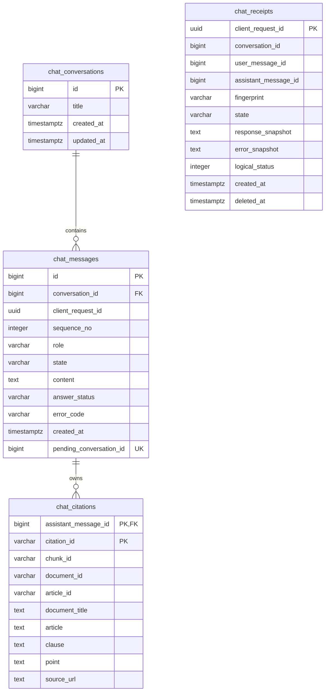

# Mô hình dữ liệu và ERD hội thoại

**Loại:** thiết kế chung Team 3. **Đối chiếu source:** `62c3556`, ngày 28/10/2026.
**Căn cứ:** [ARCHITECTURE](../ARCHITECTURE.md) §6 và [CODING_CONVENTIONS](../CODING_CONVENTIONS.md) §3.3/§4.
Đại diện Team 3 xác nhận dùng ERD này làm thiết kế chi tiết theo ARCHITECTURE ngày
29/10/2026. Ghi nhận theo vai trò/ngày, không yêu cầu danh tính hoặc nguồn bổ sung.
Xác nhận thiết kế không tự là nghiệm thu toàn bộ implementation hoặc bàn giao release.

## 1. Nguồn DDL và phạm vi

Source: [chat-schema.sql](../../team3_fullstack/backend/src/main/resources/db/chat-schema.sql),
[ChatStore](../../team3_fullstack/backend/src/main/java/com/legalai/backend/conversation/persistence/ChatStore.java),
[StreamDtos](../../team3_fullstack/backend/src/main/java/com/legalai/backend/chat/stream/StreamDtos.java).
Profile rag lưu PostgreSQL bằng JDBC, không lưu corpus/Article Store trong các bảng chat.
`spring.sql.init.mode=always` chạy DDL `CREATE ... IF NOT EXISTS` khi startup; đây là
khởi tạo idempotent, không phải migration versioned bằng Flyway/Liquibase.

## 2. ERD theo schema hiện tại

Chỉ hai đường nối thể hiện FK thực sự. Receipt có binding logic tới conversation và cặp
message qua ID; **không có FK** để giữ tombstone khi các row nội dung đã bị xóa.
`chat_citations` không có cột id riêng; khóa chính gồm assistant_message_id/citation_id.

## 3. Từ điển dữ liệu

### 3.1. chat_conversations

| Field | SQL / nullability | Ý nghĩa |
| --- | --- | --- |
| id |BIGINT identity PK, CHECK1..9007199254740991 |ID public do DB cấp |
| title |VARCHAR(400) NOT NULL |API/title builder giới hạn100 code point; column rộng hơn, không tự là giới hạn public400 |
| created_at |TIMESTAMP WITH TIME ZONE NOT NULL |Thời điểm tạo |
| updated_at |TIMESTAMP WITH TIME ZONE NOT NULL |Chạm khi nhận/chốt lượt; dùng sắp xếp sidebar |

### 3.2. chat_messages

| Field | SQL / nullability | Ý nghĩa |
| --- | --- | --- |
| id |BIGINT identity PK, CHECK1..9007199254740991 |ID message; DDL bảo vệ cùng giới hạn JS-safe như conversation |
| conversation_id |BIGINT NOT NULL FK ON DELETE CASCADE |Thuộc hội thoại |
| client_request_id |UUID NOT NULL |Cùng UUID cho user/assistant của một lượt |
| sequence_no |INTEGER NOT NULL, >0 |UNIQUE(conversation_id,sequence_no), tăng theo cặp |
| role |VARCHAR(10) NOT NULL |CHECK user/assistant |
| state |VARCHAR(10) NOT NULL |CHECK pending/completed/failed |
| content |TEXT nullable |Question user hoặc answer assistant khi completed |
| answer_status |VARCHAR(30) nullable |answered/insufficient_context ở assistant completed |
| error_code |VARCHAR(60) nullable |Lỗi assistant failed |
| created_at |TIMESTAMP WITH TIME ZONE NOT NULL |Giữ thời điểm nhận lượt khi chốt/replay |
| pending_conversation_id |BIGINT nullable UNIQUE |Chỉ assistant pending, bằng conversation_id; bảo vệ một pending/conv |

DDL CHECK: pending phải là assistant và có pending_conversation_id đúng conv; mọi trạng
thái khác phải có pending_conversation_id null. Khi không completed, content và
answer_status phải null. Ràng buộc semantics còn lại (answerStatus/citation, user completed)
được service/validator giữ, không phải tất cả đều đã có SQL CHECK.

### 3.3. chat_citations

| Field | SQL / nullability | Ý nghĩa |
| --- | --- | --- |
| assistant_message_id |BIGINT NOT NULL FK ON DELETE CASCADE |Owner; thành phần PK |
| citation_id |VARCHAR(3) NOT NULL |Thành phần PK; validator giới hạn C1..C10 |
| chunk_id |VARCHAR(200) NOT NULL |UNIQUE(assistant_message_id,chunk_id) |
| document_id |VARCHAR(200) NOT NULL |Phiên bản văn bản từ RAG |
| article_id |VARCHAR(100) NOT NULL |Điều gốc, giữ nguyên ID |
| document_title, article |TEXT NOT NULL |Nhãn văn bản/Điều |
| clause, point |TEXT nullable |Đơn vị thiếu được lưu null |
| source_url |TEXT NOT NULL |HTTPS/provenance được validator kiểm |

Không tự lưu raw chunk hoặc nội dung Điều làm căn cứ sinh mới ở đây. Viewer gọi nguồn
của cùng document_id/article_id. Truy vấn citation order theo độ dài citation_id rồi ID
để C2 đứng trước C10, tương ứng thứ tự nhãn chuẩn sau validation.

### 3.4. chat_receipts

| Field | SQL / nullability | Ý nghĩa |
| --- | --- | --- |
| client_request_id |UUID PK |Khóa idempotency toàn DB, kiểm trước khi tạo conv |
| conversation_id, user_message_id, assistant_message_id |BIGINT nullable, không FK |Binding sau accept; giữ lại khi tombstone |
| fingerprint |VARCHAR(64) nullable |SHA256 UTF-8 của question đã được Controller strip |
| state |VARCHAR(10) NOT NULL |CHECK pending/completed/failed/deleted |
| response_snapshot |TEXT nullable |JSON string Complete chuẩn để replay |
| error_snapshot |TEXT nullable |JSON string ErrorResponse |
| logical_status |INTEGER nullable |HTTP lỗi logic, không lưu200transport thay status lỗi |
| created_at |TIMESTAMP WITH TIME ZONE NOT NULL |Mốc nhận lượt/recovery |
| deleted_at |TIMESTAMP WITH TIME ZONE nullable |Mốc chuyển tombstone |

Snapshot là **TEXT chứa JSON**, không phải JSONB. Index thực tế:
`chat_receipts_pending(state,created_at)` cho recovery. Không tự thêm index khác vào tài liệu
như thể đã có trong DDL; PK/UNIQUE tạo các index ràng buộc tương ứng ở PostgreSQL.

## 4. Transaction và xóa dữ liệu

- accept: receipt + conv nếu cần + hai message + binding trong một transaction; rollback
  không để receipt/conv mồ côi khi request bị từ chối.
- complete: assistant completed + citations + response_snapshot cùng transaction.
- fail: assistant failed + error snapshot/logical status, giải phóng pending guard.
- delete: khóa conv, chặn pending; receipt→deleted và xóa nội dung atomically.
  Cascade xóa messages/citations; receipt giữ ID/time/state và deleted_at,
  xóa fingerprint/response_snapshot/error_snapshot/logical_status.

Tất cả transaction ngắn, timeout5s. Network AI luôn ngoài transaction. Cơ chế khóa,
state transition và bảng12 ca ở [thiết kế hội thoại](conversation-design.md).

## 5. Điểm cần đối chiếu, không tự coi đã hoàn thành

- Wire contract yêu cầu cả conv/message ID JS-safe; DDL đã có CHECK cận này ở
  cả conversation.id và message.id (đối chiếu lại ngày 29/10/2026).
- CHECK ở DB chưa bao phủ mọi invariant answer_status/citation; không ghi nhận mức
  bảo đảm SQL cao hơn code thực tế. Schema validation không xác nhận nội dung đúng luật.
- ERD được xác nhận dùng theo baseline ngày 29/10/2026. Khi thay mô hình vật lý,
  cập nhật DDL/ERD và kiểm chứng phần bị ảnh hưởng; không tự đổi DB để khớp hình cũ.

Nguồn kiểm chứng liên quan: [ChatStoreTests](../../team3_fullstack/backend/src/test/java/com/legalai/backend/ChatStoreTests.java),
[PostgresChatStoreTests](../../team3_fullstack/backend/src/test/java/com/legalai/backend/PostgresChatStoreTests.java).
