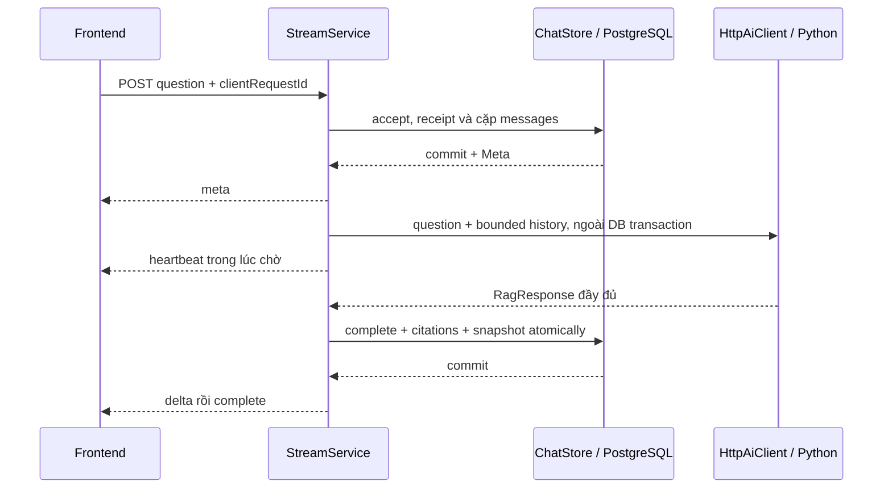

# API public và giao thức SSE

**Loại:** thiết kế chung Team 3. **Đối chiếu source:** `62c3556`, ngày 28/10/2026.
**Căn cứ:** [ARCHITECTURE](../ARCHITECTURE.md) và [CODING_CONVENTIONS](../CODING_CONVENTIONS.md).
Mô tả implementation không tự thay yêu cầu hoặc chứng minh đã nghiệm thu.

## 1. Boundary và nguồn

Thiết kế theo ARCHITECTURE §3.1/§6/§7 và CODING_CONVENTIONS §2/§3.3/§4.2.
Schema public hiện hành nằm tại [contracts/v0.1](../../contracts/v0.1/CONTRACT.md):
[query_request.schema.json](../../contracts/v0.1/query_request.schema.json) được sửa
trực tiếp theo baseline cho request; [chat_stream.schema.json](../../contracts/v0.1/chat_stream.schema.json)
bổ sung payload SSE. Tên thư mục được giữ, không đổi URL API hoặc schema nội bộ.
Request schema không còn kiểm JSON legacy; schema kiểm payload chuẩn hóa,
framing/binding/semantic có kiểm bổ sung.
Source: [StreamController](../../team3_fullstack/backend/src/main/java/com/legalai/backend/chat/stream/StreamController.java),
[StreamDtos](../../team3_fullstack/backend/src/main/java/com/legalai/backend/chat/stream/StreamDtos.java),
[StreamConversationController](../../team3_fullstack/backend/src/main/java/com/legalai/backend/conversation/StreamConversationController.java),
[PublicDocumentController](../../team3_fullstack/backend/src/main/java/com/legalai/backend/document/PublicDocumentController.java).

Public JSON UTF-8/camelCase; conversation/message ID là integer1..9007199254740991.
Không chuyển ID public thành UUID/string để khớp view model FE. Timestamp UTC;
legal IDs là chuỗi phiên bản bất biến. `clientRequestId` UUIDv4 là khóa lượt,
khác `X-Request-ID` trace mới của mỗi HTTP attempt.

## 2. Endpoint của profile rag

| Method / path | Input | Thành công |
| --- | --- | --- |
| POST `/api/v1/chat/stream` | ChatRequest JSON, không query parameter |200 text/event-stream |
| GET `/api/v1/conversations` | Không query/body |200 Conversation[], updatedAt DESC/id ASC |
| GET `/api/v1/conversations/{id}/messages` | ID số, không query/body |200 Message[], sequenceNo ASC |
| DELETE `/api/v1/conversations/{id}` | ID số, không query/body |204; pending bị409; giữ receipt tombstone |
| GET `/api/v1/documents/{documentId}?articleId=...` | Đúng một query key articleId và một giá trị |200 PublicArticle,404 nếu không có nguồn |
| POST `/api/v1/conversations` | `{}` hoặc title string1–100 code point |201 Conversation và Location |
| GET `/api/v1/conversations/{id}` | ID số, không query/body |200 Conversation |
| GET `/api/v1/health` | Không body |200 liveness, không chứng minh RAG ready |

Ba route cuối là API phụ trợ hiện có; không bắt buộc phát triển thêm chỉ vì có tên ở đây.
Danh sách trả array, không PageResponse. Không nhận history/model/scenario từ FE.
Profile rag không đăng ký `/api/v1/query` làm chat chính song song.

## 3. ChatRequest và các DTO

```json
{"question":"Điều kiện thành lập doanh nghiệp là gì?","clientRequestId":"44444444-4444-4444-8444-444444444444","conversationId":null}
```

- question bắt buộc string, strip hai đầu,1–2000 Unicode code point.
- clientRequestId bắt buộc UUIDv4; conversationId bỏ qua/null tạo conv mới hoặc số nguyên an toàn.
- Parser từ chối JSON hỏng, duplicate key, trailing token, root không object, field lạ,
  null/type sai ở field bắt buộc. [RequestParser](../../team3_fullstack/backend/src/main/java/com/legalai/backend/common/web/RequestParser.java).
- POST body tối đa16 KiB tại filter/interceptor; lỗi413/PAYLOAD_TOO_LARGE.

| DTO | Các field public hiện tại |
| --- | --- |
| Conversation |id, title, createdAt, updatedAt |
| Message |id, conversationId, clientRequestId, sequenceNo, role, state, content, answerStatus, citations, errorCode, createdAt |
| PublicCitation |citationId, chunkId, documentId, articleId, documentTitle, article, clause, point, sourceUrl |
| PublicArticle |documentId, documentTitle, articleId, article, content, sourceUrl |

clause/point nullable nhưng key vẫn có. User message: completed, content là question,
answerStatus/errorCode null, citations[]. Assistant pending/failed: content/answerStatus
null, citations[]; failed có errorCode. Assistant completed có answerStatus và answer;
insufficient_context có citations[]; answered có citation hợp lệ.

## 4. SSE và ranh giới persistence

| Frame | Số lượng theo thiết kế | Data |
| --- | --- | --- |
| meta |1 lần đầu |conversationId, clientRequestId, userMessageId, assistantMessageId, createdAt |
| Comment heartbeat |Khi chờ, khoảng10s |`:heartbeat` hoặc `: heartbeat`, không data nghiệp vụ |
| delta |0..N |Object chỉ có text |
| complete |Terminal thành công |Đúng8 field: meta5 + status, answer, citations |
| error |Terminal lỗi |ErrorResponse |

```text
event: meta
data: {"conversationId":101,"clientRequestId":"44444444-4444-4444-8444-444444444444","userMessageId":201,"assistantMessageId":202,"createdAt":"2026-10-28T00:00:00Z"}

: heartbeat

event: delta
data: {"text":"Nội dung trả lời đã được kiểm tra và lưu."}

```

Ví dụ minh họa frame, không phải đáp án pháp lý hoặc complete fixture để nghiệm thu.
Luồng thành công phải chốt complete chuẩn; không dùng riêng delta làm bản trả lời cuối.



Implementation hiện phát **một delta chứa toàn answer** khi answered; không có provider token
streaming. Insufficient không phát delta. Replay lấy snapshot, không gọi AI. Tiêu chí đầy đủ
là đúng một terminal complete hoặc error; disconnect không có nghĩa hủy xử lý AI.

## 5. Header, CORS và lỗi

`X-Request-ID` do [ApiRequestFilter](../../team3_fullstack/backend/src/main/java/com/legalai/backend/common/web/ApiRequestFilter.java)
tạo mới mỗi attempt; Java chuyển cùng trace sang Python. Stream nhận thêm
`X-Conversation-ID`; header Cache-Control:no-store và X-Accel-Buffering:no.
CORS allowlist expose X-Request-ID/X-Conversation-ID/Location, cho phép GET/POST/DELETE/OPTIONS.
Origin bị từ chối không bắt buộc có error JSON; không biến response CORS thành contract khác.

```json
{"error":{"code":"SERVICE_UNAVAILABLE","message":"Dịch vụ tạm thời không sẵn sàng.","retryable":true}}
```

| HTTP/logical status | Code | Tình huống |
| --- | --- | --- |
|400|INVALID_REQUEST|Payload/ID/query sai |
|404|CONVERSATION_NOT_FOUND, REQUEST_NOT_FOUND|Conv không tồn tại hoặc UUID đã tombstone |
|404|DOCUMENT_NOT_FOUND, ARTICLE_NOT_FOUND|Nguồn không tồn tại, không thay phiên bản |
|409|REQUEST_IN_PROGRESS, CONVERSATION_BUSY|Lượt/hội thoại pending |
|409|REQUEST_ID_CONFLICT|Cùng UUID đổi question/conv |
|413/415|PAYLOAD_TOO_LARGE, UNSUPPORTED_MEDIA_TYPE|Giới hạn body/media type |
|502|UPSTREAM_INVALID_RESPONSE, UPSTREAM_CONTRACT_ERROR, UPSTREAM_ERROR|Lỗi boundary AI |
|503|SERVICE_UNAVAILABLE, PERSISTENCE_UNAVAILABLE, PROCESSING_INTERRUPTED|Upstream/DB/recovery |
|504|UPSTREAM_TIMEOUT|Quá thời gian chờ |
|500|INTERNAL_ERROR|Lỗi ngoài dự kiến, không lộ exception/secret |

Trước khi mở SSE: HTTP error JSON. Sau khi mở200: event:error và giữ logical status
trong receipt; không đổi HTTP200 thành5xx. Failed replay trả logical error đã lưu.
Không chuyển timeout/502/503 thành insufficient_context. Mapping nội bộ chi tiết ở
[tích hợp RAG](rag-integration-specification.md#3-validation-và-mapping-lỗi).

Global handler có406/NOT_ACCEPTABLE,405/METHOD_NOT_ALLOWED,404/NOT_FOUND cho lỗi MVC
phụ trợ. Đây là implementation, không tự thành tiêu chí nghiệm thu của mọi task;
không xóa xử lý406 chỉ vì baseline không liệt kê.

## 6. Giới hạn cần phân biệt

RequestParser dùng strip/code point nhưng chưa thấy bước normalize NFC trong luồng chat
đã đọc, trong khi CODING_CONVENTIONS §2.3 yêu cầu NFC. Ghi nhận để đối chiếu trước khi
sửa code; không tự normalize/chỉnh provenance trong tài liệu. Test liên quan:
[StreamApiTests](../../team3_fullstack/backend/src/test/java/com/legalai/backend/StreamApiTests.java),
[chatStream.test.ts](../../team3_fullstack/frontend/src/api/chatStream.test.ts).
