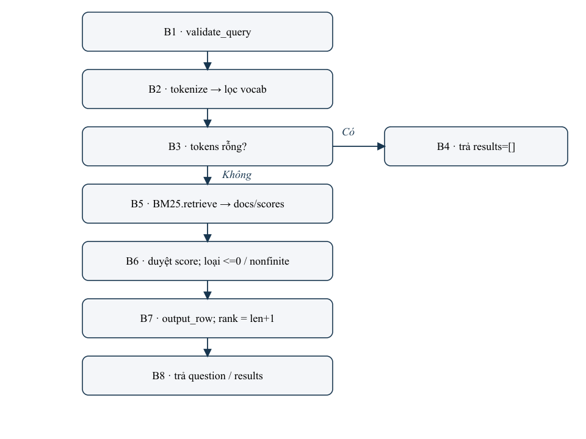
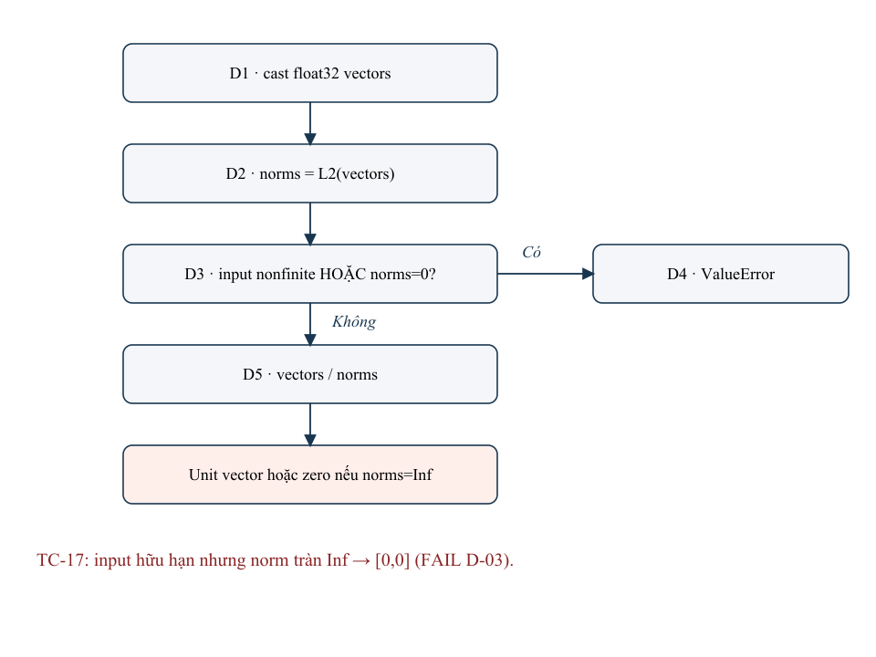

# BIÊN BẢN KIỂM THỬ RETRIEVAL

**VLRA-28 / VLRA-29 — Tuần 3, Team 3 phối hợp Team 1**

**Ngày lập:** 19/10/2026. **Phiên bản:** 1.0. **Trạng thái:** Bàn giao kỹ thuật; VLRA-29 chưa nghiệm thu.

## NHẬT KÝ CHỈNH SỬA

| Phiên bản | Ngày | Nội dung |
| --- | --- | --- |
| 1.0 | 19/10/2026 | Lập biên bản từ bằng chứng đã chạy; tham khảo hai mẫu PDF. Bỏ mô tả nghiệp vụ; chọn phương pháp phù hợp và gộp ca trùng về mục đích. Không chạy lại test hoặc thay source khi xuất biên bản. |

Tài liệu tham khảo bố cục: KiemthuhoptrangC3.pdf và KThuHopDen.pdf. Các ví dụ hàng không, chỉ tiêu C3=100% và tỷ lệ tiêu diệt lỗi trong mẫu không trở thành yêu cầu của dự án này.

## I. ĐẶC TẢ VÀ PHẠM VI

### 1.1. Thông tin biên bản

| Nội dung | Giá trị |
| --- | --- |
| Dự án / nhiệm vụ | Vietnamese Legal RAG Assistant — VLRA-28 (BM25), VLRA-29 (Dense/Hybrid); Team 3 phối hợp kiểm thử Team 1. |
| Ngày kiểm thử | 19/10/2026, múi giờ Asia/Saigon. Unit run: 03:19:09; regression: 03:19:33 theo timestamp UTC+7 trong artifact. |
| Snapshot | 5a9af42e734391e00dfc0f7ede304506fdd5a28f; working tree dirty. Không commit/push hoặc tự đổi trạng thái Jira. |
| Môi trường | Windows 11; Python 3.12.15; bm25s 0.3.14; underthesea 9.5.0; numpy 2.5.4; qdrant-client 1.19.1; jsonschema 4.26.0. |
| Profile Dense đã chạy | FakeEmbedder 64 chiều / vector kiểm soát; Qdrant in-memory. Adapter model double. Không phải benchmark model thật hoặc Qdrant server. |
| Đầu vào corpus | 2.576 chunk / 8 văn bản. Baseline 30 mẫu; supplement 8 mẫu (6 answered, 2 insufficient_context), nhóm câu hỏi ở sidecar. |
| Trạng thái bàn giao | VLRA-28: đủ scope kiểm thử/báo cáo, chưa tự phê duyệt Jira. VLRA-29: PARTIAL, còn model/server và runtime Hybrid; 3 defect Dense OPEN. |

### 1.2. Đặc tả đầu vào / đầu ra

| Đối tượng | Input / điều kiện | Expected Output |
| --- | --- | --- |
| Query chung | question là str, trim dài 1–4000 code point; K nguyên 1–50, không bool. | Input sai → ValueError; hợp lệ → question đã trim và results đúng schema v0.1. |
| Candidate | Nguồn chunk hợp lệ trong snapshot; metadata giữ nguyên. | 12 field; N≤K; rank 1..N; ID không trùng; score hữu hạn, giảm không tăng; method đúng. |
| BM25 | Index/tokenizer hiện có; no-overlap có thể không có token trong vocab. | Score dương; loại score 0/không hữu hạn; no-match trả results=[]. |
| Dense | Embedding có chiều/phân phối theo model; named cosine vector. | Không tự đặt cosine threshold; câu khác từ vẫn có nearest neighbours. Lỗi kỹ thuật không giả success rỗng. |
| Hybrid/RRF | Hai ranked lists tương thích snapshot; k=60, weights=1/1 theo thiết kế. | RRF cộng đóng góp hạng, dedup ID, tie-break best rank rồi ID; một nhánh lỗi phải lộ lỗi. Runtime hiện chưa có. |

Nguồn áp dụng: docs/team1_data/retrieval-design.md, bm25-proposal.md, dense-retrieval-proposal.md, hybrid-retrieval-proposal.md và contracts/v0.1/. Code và JSON/JUnit là căn cứ hiện trạng; testcase/schema PASS không chứng minh hiệu lực pháp lý hoặc chất lượng LLM.

## II. THIẾT KẾ KIỂM THỬ

### 2.1. Phương pháp được chọn và nguyên tắc tránh trùng

| Phương pháp | Lý do chọn | Phạm vi bằng chứng |
| --- | --- | --- |
| Contract và giá trị biên | Miền question/K có cận rõ; schema/ID/rank là giao tiếp liên team. | TC-01/02/03/19/24/25; phân hoạch hỗ trợ chọn input, không sinh thêm bộ testcase trùng. |
| Luồng điều khiển | Phân biệt invalid, no-hit, index hỏng, exception và success. | CFG rút gọn và test path tham chiếu testcase chung. Chưa thu execution trace theo node hoặc đo C3. |
| Luồng dữ liệu (DEF–USE) | ID, metadata, vectors, manifest và gold đi qua nhiều bước; lỗi có thể không hiện ở happy path. | Đối chiếu các chuỗi DEF–USE đại diện bằng test/diagnostics. Chưa đo all-defs/all-uses coverage. |

Danh sách chuẩn có 26 ca logic/nhóm mục đích (TC-01..26), ánh xạ đúng 56 unittest invocations. Mỗi invocation được gán một TC duy nhất; một TC có thể chạy trên BM25 và Dense hoặc chứa các subtest liên quan. Các phần CFG, biên và DEF–USE chỉ tham chiếu TC; không nhân bản testcase hoặc cộng lặp số lần chạy.

Không tách một bộ decision-table hoặc một bộ phân hoạch tương đương khác. Không thực hiện mutation testing. Các kiểm tra có input giống nhau nhưng thêm assertion ở tầng khác được nêu rõ: ví dụ contract từ chối input và Dense không gọi embedder; vector unit ở helper và vector sau build.

### 2.2. Kiểm thử biên và miền dữ liệu

| Biến / miền | Giá trị đã có evidence | Tham chiếu / giới hạn |
| --- | --- | --- |
| Question sai | '', whitespace, None; độ dài 4001 | TC-01. Biên độ dài tính sau trim, theo code point. |
| Question hợp lệ | Chuỗi 4000 code point; có whitespace; NFC/NFD | TC-03/04. Không tự nhận đã chạy đầy đủ 1,3999 hoặc mọi Unicode. |
| K | 1,20,50; 0,51,True,2.0; Dense thêm K=2 | TC-01/02/07. Bool bị từ chối dù là subclass của int. |
| Vector | [3,4],[-5,12]; zero/NaN/±Inf; [3e38,3e38]; sai chiều | TC-09/11/12/14/17. Overflow hữu hạn là FAIL, không được gộp vào NaN/Inf PASS. |
| Index / collection | Hợp lệ, thiếu, lệch IDs/hash/model, mất sau connect, point trùng | TC-08/09/10/14/15/16. Phân biệt lỗi kỹ thuật với retrieval rỗng. |

### 2.3. Mã nguồn và cây CFG

Hai hình dưới là CFG rút gọn theo source, không phải đồ thị đầy đủ cho từng điều kiện đơn. Nhánh của validate_query, load/connect và thư viện phụ thuộc được tách khỏi hình. Vì chưa có trace/coverage instrumentation, không điền tỷ lệ C3 hoặc khẳng định phủ mọi đường đi.

Source: team1_data/retrieval/bm25.py — BM25Retriever.retrieve; snapshot theo SHA256 trong evidence/bm25-baseline.json.

```text
 95:     def retrieve(self, question: str, top_k: int = 20) -> dict:
 96:         """Trả {question, results}; results rỗng khi không chunk nào trùng từ."""
 97:         question = validate_query(question, top_k)
 98:         vocab = self._bm25.vocab_dict
 99:         tokens = [t for t in tokenize_vi(question) if t in vocab]
100:         if not tokens:
101:             return {"question": question, "results": []}
102:         k = min(top_k, len(self.chunks))
103:         docs, scores = self._bm25.retrieve([tokens], k=k, show_progress=False)
104:         results = []
105:         for idx, score in zip(docs[0], scores[0]):
106:             score = float(score)
107:             if score <= 0 or not math.isfinite(score):
108:                 continue
109:             results.append(output_row(self.chunks[int(idx)], score, len(results) + 1, "bm25"))
110:         return {"question": question, "results": results}
```



Source: team1_data/retrieval/embedding.py — l2_normalize. Norm được định nghĩa từ vectors rồi dùng làm mẫu số; nhánh guard hiện chỉ kiểm input hữu hạn và norm=0.

```text
 28: def l2_normalize(vectors: np.ndarray) -> np.ndarray:
 29:     """Chuẩn hóa L2 theo hàng để cosine = dot product; vector 0 thì raise."""
 30:     vectors = np.asarray(vectors, dtype=np.float32)
 31:     norms = np.linalg.norm(vectors, axis=-1, keepdims=True)
 32:     if not np.all(np.isfinite(vectors)) or np.any(norms == 0):
 33:         raise ValueError("embedding contains a zero or non-finite vector")
 34:     return vectors / norms
```



### 2.4. Test path

Các path là đường đi dự kiến từ phân tích tĩnh; kết quả PASS/FAIL lấy từ testcase liên quan, không phải dấu vết node đã instrument. Không thêm testcase mới cho bảng path.

| Path | Đường đi rút gọn / mục đích | TC / kết quả |
| --- | --- | --- |
| P-01 | validate_query: invalid question/K → ValueError, dừng trước embedding. | TC-01 — PASS |
| P-02 | BM25 B1→B2→B3(no token)→B4(results=[]). | TC-07 — PASS |
| P-03 | BM25 B1→B2→B3(có token)→B5→B6(score hợp lệ)→B7→B8. | TC-06/02 — PASS; chưa chứng minh mọi vòng lặp/nhánh discard. |
| P-04 | Build/load: save → manifest/store → check IDs → query; hoặc missing/mismatch → lỗi. | TC-08/10 — PASS |
| P-05 | Normalize D1→D2→D3(input nonfinite hoặc zero norm)→D4(ValueError). | TC-12 — PASS |
| P-06 | Normalize D1→D2→D3(False)→D5(return unit vector). | TC-11 — PASS với vector thường. |
| P-07 | Normalize cùng P-06 nhưng norm=Inf; phép chia cho ra zero. | TC-17 — FAIL D-03 |
| P-08 | connect: read manifest→compare tuple/set→accept, thiếu guard prefix hoặc physical duplicate. | TC-15/16 — FAIL D-01/02 |
| P-09 | Evaluator: query error/setup error → report trạng thái lỗi, không metric success. | TC-23/26 — PASS |

### 2.5. Kiểm thử luồng dữ liệu DEF–USE

DEF là nơi dữ liệu được gán/tạo; USE là nơi được đọc để quyết định hoặc tính kết quả. Bảng chọn các chuỗi dữ liệu có rủi ro trực tiếp với retrieval. Một testcase có thể xác nhận nhiều liên kết DEF–USE; các liên kết không được tính là test mới.

| DU | DEF → biến đổi → USE | Assertion và evidence | Trạng thái |
| --- | --- | --- | --- |
| DU-01 | Corpus → filter_chunks → self.chunks/IDs → tokenizer/index hoặc payload → output_row. | Giữ chunk hợp lệ và metadata; ID fixture đúng. TC-05/06/09; evaluator so provenance với corpus. | PASS trên dữ liệu đã chạy; chưa là applicability review. |
| DU-02 | question raw → strip/validate → tokenize hoặc NFC/prefix → query vector/tokens; question trim → response. | TC-01/03/04/13: invalid không gọi embedder; NFC/trim/case/prefix đúng ở adapter double. | PASS |
| DU-03 | embed_passages/query → vectors → norms → vectors/norms → Qdrant cosine. | TC-09/11/12/17; vector thường đúng, zero/NaN/Inf bị chặn; norm overflow tạo zero. Diagnostics cosine 1.0/0.96. | PARTIAL: D-03 FAIL |
| DU-04 | save IDs/hash → manifest → connect/hash check → collection stored IDs → comparison. | TC-08/10/14: missing/hash/model mismatch bị chặn. TC-16: 5 physical points → set 4 IDs, mất thông tin trùng. | PARTIAL: D-02 FAIL |
| DU-05 | save query_prefix/passage_prefix → manifest; embedder config → connect compatibility guard → later encode. | TC-15: name/rev/dim giống nhưng query_prefix khác vẫn được nhận. Chưa dùng model thật để đo ảnh hưởng câu trả lời. | FAIL D-01: guard chưa sử dụng prefix để đối chiếu. |
| DU-06 | query results IDs → gold intersection/cutoffs → RR/Recall → aggregate denominator/group → JSON. | TC-18..25: gold rỗng/lỗi không tăng recall; candidate trùng là error; macro và percentile có oracle. | PASS công cụ |
| DU-07 | Setup/query exception → status/error → CLI exit code + persisted JSON. | TC-23/26, report file vẫn được ghi; không che bằng results=[] hoặc COMPLETE. | PASS |

Chưa đo all-defs/all-uses, chưa thu trace đầy đủ cho kill/redefinition hoặc mọi cặp DU. Nội dung trên là kiểm chứng các dataflow đại diện bằng assertion và diagnostics đã có; không thay thế chứng nhận coverage.

## III. TEST CASE

Mỗi TC chỉ mô tả một lần trong danh sách chuẩn. UT-xxx là lần chạy cụ thể trong JSON gốc; bảng đăng ký ở V.2 giữ đầy đủ tên unittest. PASS nghĩa assertion đã đạt; với ca không có output scalar lưu riêng, Actual ghi đúng mức bằng chứng assertion, không dựng giá trị trả về.

| Ca / mục đích | Input | Expected Output | Actual Output / Result | Evidence |
| --- | --- | --- | --- | --- |
| TC-01<br>Từ chối input sai trước truy vấn<br>Contract, biên, DEF–USE | question='', '   ', None, 'a'×4001 với K=5; hoặc question hợp lệ với K=0, 51, True, 2.0. Tham số hóa BM25 và Dense. | ValueError. Riêng Dense: query_calls=0, không gọi embedder khi input sai. | PASS<br>Các assertion đều đạt; kiểm tra query_calls=0 cũng đạt. Không ghi một ca mới cho mỗi phương pháp thiết kế. | UT-006<br>UT-032<br>UT-036 |
| TC-02<br>Schema và quy tắc output dùng chung<br>Contract | Fixture hợp lệ; question='doanh nghiệp'; K=1, 20, 50; lần lượt BM25/Dense. | Schema v0.1; N≤K, rank=1..N, ID duy nhất, score hữu hạn và giảm không tăng, method đúng. | PASS<br>Đạt các assertion trên fixture lành mạnh của hai implementation. | UT-007<br>UT-033 |
| TC-03<br>Trim và biên hợp lệ của question<br>Biên, DEF–USE | question có hai khoảng trắng đầu/cuối; question='a'×4000, K=50. | Question được trim; chuỗi 4000 code point được chấp nhận. | PASS<br>Đạt cho BM25 và Dense. Không suy rằng mọi điểm biên lân cận đều đã chạy. | UT-008<br>UT-034 |
| TC-04<br>Chuẩn hóa query và giữ tham chiếu pháp lý<br>DEF–USE, luồng điều khiển | Dấu thanh; Điều/Khoản/Điểm/Chương; số hiệu; dấu câu; cùng câu hỏi NFC và NFD. | Token pháp lý đúng; bỏ dấu câu; không nhận nhầm từ thường; NFC/NFD trả cùng danh sách ID. | PASS<br>Năm test tokenizer/Unicode đều đạt các assertion. | UT-013<br>UT-014<br>UT-015<br>UT-016<br>UT-048 |
| TC-05<br>Lọc corpus và từ chối dữ liệu index sai<br>DEF–USE, contract | Fixture 5 chunk, có 1 chunk hết hiệu lực; corpus sau lọc rỗng; ID trùng; point hết hiệu lực được chèn vào collection. | Index còn 4 chunk; rỗng/trùng ID bị ValueError; query không trả chunk hết hiệu lực. | PASS<br>Các assertion lọc tại build và query đều đạt. | UT-009<br>UT-011<br>UT-019<br>UT-023<br>UT-035 |
| TC-06<br>Query fixture tìm đúng ID và metadata<br>DEF–USE, chức năng | Hỏi tạm ngừng kinh doanh; chia lợi nhuận; BM25 hỏi Điều 69. K=1 hoặc 3 theo test. | ID fixture Nghị định 168/Điều 60 hoặc Luật 59/Điều 69 tương ứng; content/score/method đúng. | PASS<br>Các assertion về ID/rank đầu, nội dung và kiểu/miền score đều đạt; đây là fixture kiểm soát. | UT-004<br>UT-005<br>UT-012<br>UT-031<br>UT-037 |
| TC-07<br>Phân biệt query không khớp từ của BM25 và Dense<br>Luồng điều khiển, chức năng | question='xyz qwerty'; BM25 K=5; Dense K=50. Dense kiểm thêm K=2 cho query hợp lệ. | BM25 results=[]; Dense vẫn trả 4 hàng xóm trên fixture; K=2 trả 2 kết quả. | PASS<br>Hai hành vi riêng đều đạt. Không dùng quy tắc BM25 để ép Dense trả rỗng. | UT-010<br>UT-038 |
| TC-08<br>BM25 save/load và mismatch chunk store<br>DEF–USE, luồng điều khiển | Lưu/nạp index; nạp đường dẫn không có; store bị thay bằng chỉ 1 chunk. | Save/load trả kết quả như nhau; index thiếu hoặc store lệch gây RetrievalUnavailableError. | PASS<br>Ba test persistence BM25 đều đạt; manifest version/count được assert. | UT-001<br>UT-002<br>UT-003 |
| TC-09<br>Dense build: vectors, payload và collection<br>DEF–USE, luồng điều khiển | FakeEmbedder 64 chiều; 4 chunk hợp lệ; build lần hai cùng collection; embedder trả 32 chiều. | UUID5 mapping; payload gốc; named vector cosine/alias đúng; vectors L2=1; collection trùng và shape sai bị từ chối. | PASS<br>Năm test build tương ứng đều đạt. | UT-017<br>UT-018<br>UT-020<br>UT-021<br>UT-022 |
| TC-10<br>Dense persist/connect và lỗi dịch vụ<br>DEF–USE, luồng điều khiển | Manifest/cache đã lưu; model revision đổi; collection/IDs thiếu; server unreachable; collection mất sau connect. | Cache/manifest đúng; reconnect cùng dữ liệu giữ kết quả; trạng thái bất nhất hoặc dịch vụ lỗi không thành success rỗng. | PASS<br>Bảy test persistence Dense đều đạt. Các lỗi prefix/point trùng được tách ở TC-15/16. | UT-024<br>UT-025<br>UT-026<br>UT-027<br>UT-028<br>UT-029<br>UT-030 |
| TC-11<br>Chuẩn hóa L2 trên vector thường<br>DEF–USE | [[3,4],[-5,12]]. | [[0.6,0.8],[-5/13,12/13]], sai số 1e-6. | PASS<br>assert_allclose đạt. Kiểm ở helper khác với kiểm vector đã đi qua build ở TC-09. | UT-055 |
| TC-12<br>Từ chối vector zero/NaN/Inf<br>Biên số học, DEF–USE | [0,0], [NaN,1], [Inf,1], [-Inf,1]. | ValueError trước khi dùng vector cho truy vấn. | PASS<br>Các subtest đều đạt trong một unittest method. | UT-056 |
| TC-13<br>Adapter giữ case, NFC, trim và prefix<br>DEF–USE | Chuỗi NFD có khoảng trắng; query_prefix='query: ', passage_prefix='passage: '; model double. | Dữ liệu encode là 'query: Điều 17' và 'passage: Điều 17'. | PASS<br>Assertion danh sách dữ liệu truyền vào encode đạt. Không load model thật. | UT-053 |
| TC-14<br>Integrity: hash manifest và chiều query<br>DEF–USE, luồng điều khiển | Manifest chunk_ids_sha256='bad-hash'; hoặc query vector 3 chiều cho index 64 chiều. | Hash sai bị RetrievalUnavailableError; sai chiều phát sinh lỗi, không thành results=[] hợp lệ. | PASS<br>Hai test guard đều đạt; artifact không lưu riêng lớp exception của ca sai chiều. | UT-051<br>UT-052 |
| TC-15<br>Query prefix không khớp manifest<br>DEF–USE | Manifest query_prefix='query: '; embedder.query_prefix='different: '; name/revision/dim vẫn giống. | Connect từ chối cấu hình embedding không tương thích. | FAIL<br>Không raise RetrievalUnavailableError; D-01. Chưa đo tác động semantic bằng model thật. | UT-049 |
| TC-16<br>Point trùng chunk_id bị mất dấu khi đổi sang set<br>DEF–USE | 4 chunk; chèn UUID khác mang payload chunk_id cũ → collection có 5 point. | Connect từ chối dữ liệu trùng; không trả duplicate chunk_id. | FAIL<br>Connect vẫn nhận; diagnostics trả 5 rows/4 ID duy nhất; D-02. | UT-050 |
| TC-17<br>Overflow của norm float32<br>Biên số học, DEF–USE | Vector hữu hạn [3e38,3e38]. | Unit vector hợp lệ hoặc ValueError rõ ràng. | FAIL<br>Output [0,0], norm=0 thay vì 1; D-03. Ca cực trị, không đại diện output thường của model. | UT-054 |
| TC-18<br>Oracle Recall và reciprocal rank<br>DEF–USE | IDs=[x,b,a], gold=[a,b]; thêm trường hợp a ở rank5 và b ở rank6. | Recall5/20=1, RR10=1/2; ví dụ thứ hai Recall5=1/2, RR10=1/5. | PASS<br>Các assertion công thức đạt. | UT-045 |
| TC-19<br>Cutoff và query miss<br>Biên, DEF–USE | Relevant ở rank11; hoặc không có candidate relevant. | RR10=0; miss có Recall20=0. | PASS<br>Các assertion cutoff đạt. | UT-040 |
| TC-20<br>Gold rỗng không tạo Recall hoàn hảo<br>DEF–USE | Gold=[]; retriever vẫn trả candidate. | Recall/MRR của mẫu bằng null, không phải 1. | PASS<br>Các metric đều None/null theo assertion. | UT-042 |
| TC-21<br>Nội suy percentile<br>DEF–USE | Latencies=[1,2,3,4]; và danh sách rỗng. | p50=2.5, p95=3.85; rỗng → null. | PASS<br>Các assertion nội suy đạt. | UT-046 |
| TC-22<br>Macro và denominator<br>DEF–USE | Hai mẫu answered có recall 0.5 và 1; một mẫu gold rỗng. | Macro Recall20=0.75, scored=2, empty_gold=1. | PASS<br>Các assertion tổng hợp đạt. | UT-044 |
| TC-23<br>Query exception không bị giấu trong metric<br>Luồng điều khiển, DEF–USE | Retriever double ném RuntimeError. | Run ERROR, errors=1, scored=0, Recall20=null. | PASS<br>Các assertion status/denominator đạt. | UT-043 |
| TC-24<br>Candidate trùng không tăng số hit<br>Contract, DEF–USE | Output chứa hai rows cùng chunk_id. | Evaluator ghi error, không chấm thành hai hit. | PASS<br>errors=1 theo assertion. Đây là guard của evaluator; khác TC-16 kiểm retriever. | UT-041 |
| TC-25<br>Golden sai không đi vào denominator<br>Contract, DEF–USE | Gold ID ngoài corpus; case ID trùng; expected_status không hợp lệ. | ValueError tại validate_cases. | PASS<br>Các assertion từ chối dữ liệu đạt. | UT-047 |
| TC-26<br>CLI setup failure vẫn có report<br>Luồng điều khiển, contract | --golden trỏ file không tồn tại; --output hợp lệ. | Exit 2; JSON status=BLOCKED. | PASS<br>Report tồn tại và status/exit code đúng. Đây là negative test PASS. | UT-039 |

## IV. BÁO CÁO KIỂM THỬ

### 4.1. Kết quả thực thi

| Bộ kiểm thử | Tổng | PASS | FAIL | ERROR | SKIP |
| --- | --- | --- | --- | --- | --- |
| Retrieval sau bổ sung | 56 | 53 | 3 | 0 | 0 |
| Regression toàn tests/ | 81 | 76 | 3 | 2 | 0 |
| Preprocess chạy riêng | 3 | 1 | 0 | 2 | 0 |

Ba dòng là các lần chạy có phần chồng nhau; không cộng thành 140 test. Bộ retrieval gồm BM25 16 method + 1 edge, Dense 22 method + 8 edge, evaluator 9 method = 56. Baseline trước refactor là BM25 18/18 và Dense 22/22; số method thay đổi do gom generic checks vào mixin, không là phép cộng số test mới.

| Phần | Đã xác minh | Giới hạn |
| --- | --- | --- |
| BM25 | 17/17 invocations liên quan BM25 PASS (16 file gốc sau refactor + 1 Unicode edge). | Relevance corpus có MATCH/PARTIAL/MISS; không có ngưỡng chất lượng BM25 tự đặt. |
| Dense kiểm soát | 27 PASS / 3 FAIL trên 30 invocations; cosine fixture khớp 1.0/0.96 trong sai số 1e-6. | Không phải model thật; collection bị duplicate làm guard/ID uniqueness FAIL. |
| Evaluator | 9/9 PASS, có oracle, denominator và nhánh lỗi. | Metric exact chunk-ID, chưa phải unit-group recall; nhãn draft chưa legal review. |
| Dense thật / server | BLOCKED, metrics=null. | RAM trống khoảng 1,1 GB; weights FP32 riêng đã cần khoảng 2,12 GiB. Docker version API lỗi500. Chưa tải/load weights. |
| Hybrid | BLOCKED, runtime chưa có. | Oracle RRF chỉ tham chiếu; không chấm Hybrid PASS bằng công thức hoặc skip. |

### 4.2. Kết quả Top-K và chunk_id trên corpus

| Dataset | Scored | Recall@5 | Recall@20 | MRR@10 | p50/p95 ms |
| --- | --- | --- | --- | --- | --- |
| Baseline30 | 30/30 | 0.496842 | 0.738160 | 0.666667 | 2.220/4.635 |
| Supplement8 | 6/8 | 0.833333 | 0.833333 | 0.833333 | 1.655/138.707 |

Recall@K=|gold∩topK|/|gold|, lấy macro trên answered; MRR@10 dùng relevant đầu tiên. Hai mẫu gold rỗng không tính Recall/MRR. Query top20 cùng lần chạy cung cấp cutoffs5/20/10. Latency chỉ retrieve, không gồm build/load/validation, không warmup; p95 bộ8 mẫu nhạy cold call, không là xác nhận SLA.

Bảng sau là quan sát relevance theo nhãn corpus, tách khỏi PASS/FAIL unit. Mỗi ID truy ngược về question, expected IDs, actual top20/rank/score ở evidence/bm25-cases.csv và JSON. MATCH=đủ gold trong top20; PARTIAL=chỉ có một phần; MISS=không có; NOT_SCORED=gold rỗng. Không thêm 38 quan sát này vào số56 unit methods.

| Case ID | Question / Input (K=20) | Gold | Hit5/20 | Rank đầu | Kết luận |
| --- | --- | --- | --- | --- | --- |
| gold_001 | Luật Doanh nghiệp quy định về những vấn đề gì? | 1 | 0/0 | — | MISS |
| gold_002 | Những ai thuộc đối tượng áp dụng của Luật Doanh nghiệp? | 2 | 1/2 | 4 | MATCH |
| gold_003 | Theo Luật Doanh nghiệp, cổ đông là ai? | 1 | 0/0 | — | MISS |
| gold_004 | Vốn điều lệ của công ty trách nhiệm hữu hạn được xác định như thế nào? | 1 | 0/0 | — | MISS |
| gold_005 | Doanh nghiệp có những quyền gì theo Điều 7 Luật Doanh nghiệp? | 11 | 3/10 | 1 | PARTIAL |
| gold_006 | Công ty TNHH hai thành viên trở lên được có tối thiểu và tối đa bao nhiêu thành viên? Thành viên có thể là tổ chức không? | 1 | 0/1 | 6 | MATCH |
| gold_007 | Thành viên công ty TNHH hai thành viên trở lên phải góp đủ vốn đã cam kết trong bao lâu? Thời gian vận chuyển, nhập khẩu tài sản góp vốn và làm thủ tục chuyển quyền sở hữu có tính vào thời hạn này không? | 1 | 1/1 | 2 | MATCH |
| gold_008 | Khi thành viên góp vốn vào công ty TNHH bằng tài sản có đăng ký quyền sở hữu, việc chuyển quyền sở hữu tài sản đó cho công ty có phải chịu lệ phí trước bạ không? | 1 | 1/1 | 2 | MATCH |
| gold_009 | Công ty cổ phần phải có ít nhất bao nhiêu cổ đông và có giới hạn số lượng cổ đông tối đa không? | 1 | 1/1 | 4 | MATCH |
| gold_010 | Doanh nghiệp tư nhân có được phát hành chứng khoán để huy động vốn không? | 1 | 1/1 | 2 | MATCH |
| gold_011 | Theo Điều 16 Luật Doanh nghiệp, những hành vi nào bị nghiêm cấm trong đăng ký doanh nghiệp và hoạt động kinh doanh? | 7 | 4/7 | 1 | MATCH |
| gold_012 | Hồ sơ đăng ký công ty hợp danh gồm những giấy tờ gì theo Điều 20 Luật Doanh nghiệp? | 5 | 3/5 | 1 | MATCH |
| gold_013 | Giấy đề nghị đăng ký doanh nghiệp phải có những nội dung chủ yếu nào theo Điều 23 Luật Doanh nghiệp? | 9 | 4/9 | 1 | MATCH |
| gold_014 | Điều lệ công ty phải quy định những nội dung chủ yếu nào theo Điều 24 Luật Doanh nghiệp? | 4 | 2/3 | 1 | PARTIAL |
| gold_015 | Giấy chứng nhận đăng ký doanh nghiệp gồm những nội dung chủ yếu nào theo Điều 28 Luật Doanh nghiệp? | 4 | 3/4 | 1 | MATCH |
| gold_016 | So sánh các loại hình doanh nghiệp theo Luật Doanh nghiệp 2020: công ty trách nhiệm hữu hạn hai thành viên trở lên, công ty trách nhiệm hữu hạn một thành viên, công ty cổ phần, công ty hợp danh và doanh nghiệp tư nhân khác nhau thế nào về chủ sở hữu và mức chịu trách nhiệm về nợ? | 5 | 2/2 | 2 | PARTIAL |
| gold_017 | Cổ đông công ty cổ phần chịu trách nhiệm về nợ của công ty trong phạm vi nào và có những nghĩa vụ gì? | 7 | 2/2 | 1 | PARTIAL |
| gold_018 | Công ty trách nhiệm hữu hạn và công ty cổ phần có thể có bao nhiêu người đại diện theo pháp luật, và người đại diện theo pháp luật phải thực hiện những trách nhiệm gì? | 3 | 1/1 | 2 | PARTIAL |
| gold_019 | Doanh nghiệp bị giải thể trong những trường hợp nào, phải đáp ứng điều kiện gì, và với trường hợp tự giải thể thì phải gửi hồ sơ cho cơ quan đăng ký kinh doanh theo các mốc thời hạn nào? | 5 | 0/0 | — | MISS |
| gold_020 | Chủ sở hữu hưởng lợi của doanh nghiệp được xác định theo tiêu chí nào, doanh nghiệp phải kê khai những thông tin gì và lưu giữ danh sách này ra sao? | 6 | 2/5 | 3 | PARTIAL |
| gold_021 | Luật số 76/2025/QH15 sửa đổi Luật Doanh nghiệp theo hướng nào để quản lý thông tin về chủ sở hữu hưởng lợi? | 10 | 4/10 | 1 | MATCH |
| gold_022 | Luật số 76/2025/QH15 có hiệu lực từ khi nào, doanh nghiệp thành lập trước ngày luật có hiệu lực phải bổ sung thông tin chủ sở hữu hưởng lợi vào thời điểm nào, và các đợt chào bán trái phiếu riêng lẻ đã công bố thông tin trước đó áp dụng quy định nào? | 3 | 2/2 | 1 | PARTIAL |
| gold_023 | Theo văn bản hợp nhất Nghị định hướng dẫn Luật Doanh nghiệp (7566/VBHN-BKHĐT), doanh nghiệp xã hội được xác định theo quy định nào, phải duy trì những cam kết gì và ai phải chịu trách nhiệm liên đới khi doanh nghiệp xã hội vi phạm? | 3 | 2/2 | 1 | PARTIAL |
| gold_024 | Doanh nghiệp nhà nước công bố thông tin bằng hình thức và phương tiện nào, báo cáo công bố qua mạng điện tử có giá trị pháp lý ra sao và phải được duy trì tối thiểu bao lâu? | 4 | 2/4 | 2 | MATCH |
| gold_025 | Theo Nghị định 122/2021/NĐ-CP, vi phạm hành chính trong lĩnh vực đăng ký doanh nghiệp bị xử phạt bằng những hình thức nào, mức phạt tiền tối đa là bao nhiêu, mức phạt đối với cá nhân so với tổ chức ra sao và thời hiệu xử phạt là bao lâu? | 5 | 3/4 | 1 | PARTIAL |
| gold_026 | Công ty hết thời hạn hoạt động ghi trong Điều lệ mà không thực hiện thủ tục giải thể thì bị phạt bao nhiêu, phải khắc phục hậu quả thế nào và mức phạt đó áp dụng cho tổ chức hay cá nhân? | 3 | 2/3 | 1 | MATCH |
| gold_027 | Theo Nghị định 288/2026/NĐ-CP, kê khai không trung thực hồ sơ đăng ký doanh nghiệp và chậm đăng ký thay đổi nội dung đăng ký doanh nghiệp bị xử phạt như thế nào? | 5 | 1/5 | 1 | MATCH |
| gold_028 | Nghị định 288/2026/NĐ-CP bãi bỏ những quy định nào của Nghị định 122/2021/NĐ-CP, có hiệu lực từ khi nào và ai chịu trách nhiệm hướng dẫn thi hành? | 3 | 3/3 | 1 | MATCH |
| gold_029 | Thông tư 68/2025/TT-BTC ban hành biểu mẫu cho những hoạt động nào, áp dụng cho đối tượng nào, có hiệu lực từ khi nào và làm hết hiệu lực hoặc bãi bỏ những văn bản nào? | 7 | 5/7 | 1 | MATCH |
| gold_030 | Doanh nghiệp tạm ngừng kinh doanh phải gửi thông báo trước ít nhất mấy ngày làm việc, hồ sơ gồm những giấy tờ nào, và hành vi không thông báo tạm ngừng kinh doanh bị xử phạt thế nào? | 4 | 2/2 | 1 | PARTIAL |
| retrieval_qa_031 | Điều 1 Nghị định 168/2025/NĐ-CP quy định phạm vi đăng ký doanh nghiệp và hộ kinh doanh như thế nào? | 1 | 1/1 | 1 | MATCH |
| retrieval_qa_032 | Nghị định 122/2021/NĐ-CP khoản 1 Điều 1 xử phạt vi phạm hành chính trong lĩnh vực nào? | 1 | 1/1 | 1 | MATCH |
| retrieval_qa_033 | Biểu mẫu để đăng ký công ty được đặt trong phụ lục nào của thông tư về biểu mẫu đăng ký? | 1 | 1/1 | 1 | MATCH |
| retrieval_qa_034 | Theo khoản 2 Điều 2 Thông tư 68/2025/TT-BTC, biểu mẫu đăng ký hộ kinh doanh nằm ở đâu? | 1 | 1/1 | 1 | MATCH |
| retrieval_qa_035 | Theo Điều 3 Văn bản hợp nhất 67/VBHN-VPQH, nếu luật khác có quy định đặc thù về thành lập doanh nghiệp thì áp dụng quy định nào? | 1 | 1/1 | 1 | MATCH |
| retrieval_qa_036 | Bản hợp nhất nghị định hướng dẫn luật doanh nghiệp có quy định về công bố thông tin của doanh nghiệp nhà nước không? | 1 | 0/0 | — | MISS |
| retrieval_qa_037 | Thủ tục nhận con nuôi có yếu tố nước ngoài gồm những giấy tờ nào? | 0 | 0/0 | — | NOT_SCORED |
| retrieval_qa_038 | Người lao động nghỉ thai sản được hưởng bảo hiểm xã hội trong bao lâu? | 0 | 0/0 | — | NOT_SCORED |

Baseline có14/30 mẫu chưa đủ gold ở top20, trong đó4 miss hoàn toàn; supplement có1/6 answered miss. Exact-ID labels có thể chưa bao quát các chunk tương đương của bản hợp nhất; cần reviewer đối chiếu, không tự sửa expected theo output. Không so số0.738160 với số0.805 minh họa khi chưa có protocol/hash lần cũ.

### 4.3. Lỗi được phát hiện

| ID / mức độ | Expected / Actual | Ca / owner |
| --- | --- | --- |
| D-01 / MEDIUM | Prefix không tương thích cần bị từ chối; actual connect vẫn nhận. Chưa đo ảnh hưởng semantic với model thật. | TC-15; Team1 |
| D-02 / HIGH | Collection trùng chunk_id phải bị từ chối; actual connect nhận, query5rows/4IDs. | TC-16; Team1 |
| D-03 / LOW | Normalize phải tạo unit vector hoặc lỗi; actual [3e38,3e38]→[0,0]. Đây là ca cực trị. | TC-17; Team1 |
| R-P01 / MEDIUM | Preprocess gọi chunk_document nhưng chunker không có hàm; 2ERROR trong regression và isolated. | Ngoài scope retrieval; Team1. Source không đổi. |

### 4.4. Lỗi được cấy, lỗi bỏ sót và độ bao phủ

Không cấy lỗi hoặc chạy mutation testing; không có tập mutant gốc để tính tỷ lệ tiêu diệt lỗi. Không suy 3FAIL là 3 trên tổng số lỗi của hệ thống. 'Lỗi bỏ sót' chưa xác định được; các khoảng chưa kiểm chứng gồm model thật, Qdrant server, Hybrid runtime, đầy đủ DU pairs/điều kiện C3 và legal applicability. Không điền 100% C3 hoặc all-uses.

### 4.5. Kết luận bàn giao

VLRA-28: hoàn thành công việc kiểm thử/báo cáo trong scope tester; reviewer quyết định chấp nhận bàn giao. Không kết luận mọi câu hỏi đều đủ căn cứ. VLRA-29: PARTIAL; T005(model thật/server) và T007(Hybrid runtime) còn mở. Ba defect Dense OPEN; không tự sửa production để đổi FAIL thành PASS. Chưa nghiệm thu toàn tuần hoặc tự cập nhật Jira.

## V. MINH CHỨNG THỰC THI

### 5.1. Lệnh và nguồn bằng chứng

```text
$py = '.local/team3/retrieval-audit-20261019/venv/Scripts/python.exe'
& $py scripts/run_retrieval_tests.py --output-dir .local/team3/retrieval-audit-20261019/final-unit
& $py scripts/run_retrieval_tests.py --pattern 'test*.py' --output-dir .local/team3/retrieval-audit-20261019/full-regression
& $py scripts/eval_retrieval.py --method bm25 --index .local/team3/retrieval-audit-20261019/bm25 --golden team2_rag/data/golden/golden_phase1_30cai.json --groups specs/team3/week-03/data/query_groups.json --output .local/team3/retrieval-audit-20261019/bm25-baseline.json
```

Các lệnh trên tái hiện lần kiểm thử trước; lượt xuất biên bản này không chạy lại. CLI negative test thiếu file có status BLOCKED/exit2 là expected PASS của TC-26. Windows sandbox từng chặn TemporaryDirectory; lần có kết quả cuối được chạy ngoài sandbox có kiểm soát.

| File trong specs/team3/week-03/evidence/ | Vai trò |
| --- | --- |
| unit-results.json / junit.xml | 56 invocations, trạng thái và traceback; nguồn ánh xạ testcase. |
| regression-results.json / regression-junit.xml | 81 invocations; bao gồm hai lỗi preprocess. |
| preprocess-isolated.json | Xác nhận2ERROR ngoài scope vẫn tái hiện khi chạy riêng. |
| bm25-baseline.json / bm25-supplement.json | Question, expected IDs, top20 thực tế/rank/score, metrics/nhóm và hashes. |
| bm25-cases.csv | Bảng từng câu hỏi và verdict exact-ID. |
| dense-diagnostics.json | Cosine kiểm soát và duplicate/overflow numeric actual. |
| dense-real.json / hybrid.json / rrf-oracle.json | Dependency BLOCKED và oracle tham chiếu; không là runtime PASS. |
| golden-validation.json / test-inventory.json | Validator30+8, giới hạn legal review, map baseline sang mixin. |
| commands.json / final-validation.json | Lệnh, source-preservation/link checks của lượt kiểm thử trước. |

| Snapshot input | SHA256 |
| --- | --- |
| Corpus chunks.jsonl | 37aa6dea2b33a94f9ecc5020796d150f43f8a1dc5ef4d3e797fa9cb1d1707d66 |
| Golden baseline | 383b57e9d63cf014e9adb7c25c61beb71bf4844efb6b7eb0a6662594ffac0740 |

### 5.2. Danh sách đầy đủ 56 lần chạy và ánh xạ ca

Mỗi UT xuất hiện một lần và thuộc đúng một TC. Tên module tương ứng file trong tests/. Tên function giữ nguyên để tra JSON; trạng thái lấy trực tiếp từ artifact, không thay từ biên bản.

| UT | TC | Unittest method / nguồn | Result |
| --- | --- | --- | --- |
| UT-001 | TC-08 | test_bm25_retrieval<br>BM25PersistenceTest.<br>test_load_missing_index_raises | PASS |
| UT-002 | TC-08 | test_bm25_retrieval<br>BM25PersistenceTest.<br>test_load_rejects_chunk_store_that_does_not_match | PASS |
| UT-003 | TC-08 | test_bm25_retrieval<br>BM25PersistenceTest.<br>test_save_and_load_give_same_results | PASS |
| UT-004 | TC-06 | test_bm25_retrieval<br>BM25RetrieverTest.<br>test_article_reference_query | PASS |
| UT-005 | TC-06 | test_bm25_retrieval<br>BM25RetrieverTest.<br>test_basic_query_ranks_matching_chunk_first | PASS |
| UT-006 | TC-01 | test_bm25_retrieval<br>BM25RetrieverTest.<br>test_contract_rejects_eight_invalid_inputs | PASS |
| UT-007 | TC-02 | test_bm25_retrieval<br>BM25RetrieverTest.<br>test_contract_schema_and_semantics | PASS |
| UT-008 | TC-03 | test_bm25_retrieval<br>BM25RetrieverTest.<br>test_contract_trim_and_boundaries | PASS |
| UT-009 | TC-05 | test_bm25_retrieval<br>BM25RetrieverTest.<br>test_index_skips_chunks_outside_default_legal_status | PASS |
| UT-010 | TC-07 | test_bm25_retrieval<br>BM25RetrieverTest.<br>test_no_matching_word_returns_empty_results | PASS |
| UT-011 | TC-05 | test_bm25_retrieval<br>BM25RetrieverTest.<br>test_rejects_empty_or_duplicate_corpus | PASS |
| UT-012 | TC-06 | test_bm25_retrieval<br>BM25RetrieverTest.<br>test_result_has_chunk_id_content_and_score | PASS |
| UT-013 | TC-04 | test_bm25_retrieval<br>TokenizerTest.<br>test_does_not_treat_common_words_as_references | PASS |
| UT-014 | TC-04 | test_bm25_retrieval<br>TokenizerTest.<br>test_keeps_legal_references_as_single_tokens | PASS |
| UT-015 | TC-04 | test_bm25_retrieval<br>TokenizerTest.<br>test_normalises_tone_placement_only_at_syllable_end | PASS |
| UT-016 | TC-04 | test_bm25_retrieval<br>TokenizerTest.<br>test_segments_words_and_drops_punctuation | PASS |
| UT-017 | TC-09 | test_dense_retrieval<br>DenseIndexingTest.<br>test_collection_uses_named_cosine_vector_and_alias | PASS |
| UT-018 | TC-09 | test_dense_retrieval<br>DenseIndexingTest.<br>test_embeddings_are_l2_normalised | PASS |
| UT-019 | TC-05 | test_dense_retrieval<br>DenseIndexingTest.<br>test_index_skips_chunks_outside_default_legal_status | PASS |
| UT-020 | TC-09 | test_dense_retrieval<br>DenseIndexingTest.<br>test_points_use_uuid5_ids_and_full_chunk_payload | PASS |
| UT-021 | TC-09 | test_dense_retrieval<br>DenseIndexingTest.<br>test_rebuilding_existing_collection_is_refused | PASS |
| UT-022 | TC-09 | test_dense_retrieval<br>DenseIndexingTest.<br>test_rejects_embedder_with_wrong_dimension | PASS |
| UT-023 | TC-05 | test_dense_retrieval<br>DenseIndexingTest.<br>test_rejects_empty_or_duplicate_corpus | PASS |
| UT-024 | TC-10 | test_dense_retrieval<br>DensePersistenceTest.<br>test_collection_dropped_after_connect_raises_on_retrieve | PASS |
| UT-025 | TC-10 | test_dense_retrieval<br>DensePersistenceTest.<br>test_connect_gives_same_results | PASS |
| UT-026 | TC-10 | test_dense_retrieval<br>DensePersistenceTest.<br>test_connect_missing_index_or_collection_raises | PASS |
| UT-027 | TC-10 | test_dense_retrieval<br>DensePersistenceTest.<br>test_connect_rejects_collection_that_does_not_match_manifest | PASS |
| UT-028 | TC-10 | test_dense_retrieval<br>DensePersistenceTest.<br>test_connect_rejects_different_embedding_model | PASS |
| UT-029 | TC-10 | test_dense_retrieval<br>DensePersistenceTest.<br>test_save_writes_manifest_and_embedding_cache | PASS |
| UT-030 | TC-10 | test_dense_retrieval<br>DensePersistenceTest.<br>test_unreachable_qdrant_raises_retrieval_unavailable | PASS |
| UT-031 | TC-06 | test_dense_retrieval<br>DenseRetrieverTest.<br>test_basic_query_ranks_matching_chunk_first | PASS |
| UT-032 | TC-01 | test_dense_retrieval<br>DenseRetrieverTest.<br>test_contract_rejects_eight_invalid_inputs | PASS |
| UT-033 | TC-02 | test_dense_retrieval<br>DenseRetrieverTest.<br>test_contract_schema_and_semantics | PASS |
| UT-034 | TC-03 | test_dense_retrieval<br>DenseRetrieverTest.<br>test_contract_trim_and_boundaries | PASS |
| UT-035 | TC-05 | test_dense_retrieval<br>DenseRetrieverTest.<br>test_query_filter_excludes_chunks_outside_legal_status | PASS |
| UT-036 | TC-01 | test_dense_retrieval<br>DenseRetrieverTest.<br>test_rejects_invalid_input_before_embedding | PASS |
| UT-037 | TC-06 | test_dense_retrieval<br>DenseRetrieverTest.<br>test_result_has_chunk_id_content_and_cosine_score | PASS |
| UT-038 | TC-07 | test_dense_retrieval<br>DenseRetrieverTest.<br>test_top_k_limits_results_and_unrelated_query_still_returns_neighbours | PASS |
| UT-039 | TC-26 | test_eval_retrieval<br>MetricTests.<br>test_cli_setup_failure_still_writes_json_and_nonzero_exit | PASS |
| UT-040 | TC-19 | test_eval_retrieval<br>MetricTests.<br>test_cutoff_and_miss | PASS |
| UT-041 | TC-24 | test_eval_retrieval<br>MetricTests.<br>test_duplicate_candidate_is_error_not_extra_hit | PASS |
| UT-042 | TC-20 | test_eval_retrieval<br>MetricTests.<br>test_empty_gold_is_not_perfect_recall | PASS |
| UT-043 | TC-23 | test_eval_retrieval<br>MetricTests.<br>test_errors_are_reported_and_run_fails | PASS |
| UT-044 | TC-22 | test_eval_retrieval<br>MetricTests.<br>test_macro_average_and_empty_gold_denominator | PASS |
| UT-045 | TC-18 | test_eval_retrieval<br>MetricTests.<br>test_partial_recall_and_first_relevant_rr | PASS |
| UT-046 | TC-21 | test_eval_retrieval<br>MetricTests.<br>test_percentile_linear_interpolation | PASS |
| UT-047 | TC-25 | test_eval_retrieval<br>MetricTests.<br>test_unknown_gold_duplicate_cases_and_invalid_status_are_rejected | PASS |
| UT-048 | TC-04 | test_retrieval_edge_cases<br>BM25EdgeTests.<br>test_nfc_and_nfd_queries_retrieve_same_ids | PASS |
| UT-049 | TC-15 | test_retrieval_edge_cases<br>DenseIntegrityTests.<br>test_connect_rejects_changed_query_prefix | FAIL |
| UT-050 | TC-16 | test_retrieval_edge_cases<br>DenseIntegrityTests.<br>test_connect_rejects_duplicate_physical_point_for_same_chunk | FAIL |
| UT-051 | TC-14 | test_retrieval_edge_cases<br>DenseIntegrityTests.<br>test_manifest_id_hash_mismatch_rejected | PASS |
| UT-052 | TC-14 | test_retrieval_edge_cases<br>DenseIntegrityTests.<br>test_query_dimension_mismatch_is_not_empty_success | PASS |
| UT-053 | TC-13 | test_retrieval_edge_cases<br>EmbeddingEdgeTests.<br>test_adapter_nfc_trim_case_and_prefix_without_loading_model | PASS |
| UT-054 | TC-17 | test_retrieval_edge_cases<br>EmbeddingEdgeTests.<br>test_large_finite_vectors_never_silently_become_zero | FAIL |
| UT-055 | TC-11 | test_retrieval_edge_cases<br>EmbeddingEdgeTests.<br>test_normal_vectors_have_unit_length | PASS |
| UT-056 | TC-12 | test_retrieval_edge_cases<br>EmbeddingEdgeTests.<br>test_zero_and_nonfinite_vectors_rejected | PASS |

### 5.3. Xác nhận và việc tiếp tục

Biên bản ghi kết quả kỹ thuật; chưa có chữ ký/phê duyệt của reviewer. Người kiểm thử, người phụ trách module và người nghiệm thu điền xác nhận khi review.

| Vai trò | Xác nhận |
| --- | --- |
| Người lập / nhóm kiểm thử | Team 3 — tổng hợp evidence hiện có; chờ review. |
| Owner module | Team 1 — review D-01/D-02/D-03 và lỗi preprocess; bàn giao Hybrid theo VLRA-27. |
| Người nghiệm thu | Chưa xác nhận. VLRA-29 còn dependency; chưa nghiệm thu toàn tuần. |

## Truy cập bằng chứng

[Báo cáo gốc](../verification.md) · [Unit JSON](../evidence/unit-results.json) · [JUnit](../evidence/junit.xml) · [Corpus CSV](../evidence/bm25-cases.csv) · [Dense issues](../002-vlra-29-dense-hybrid-tests/issues.md)
